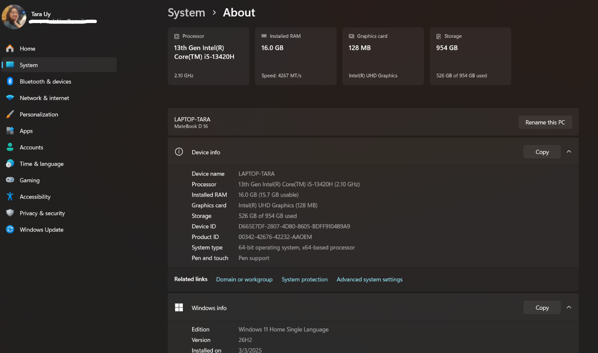
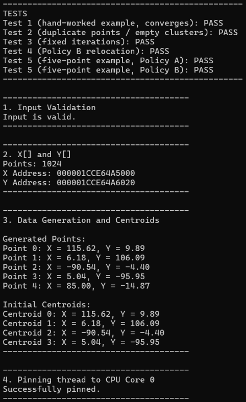
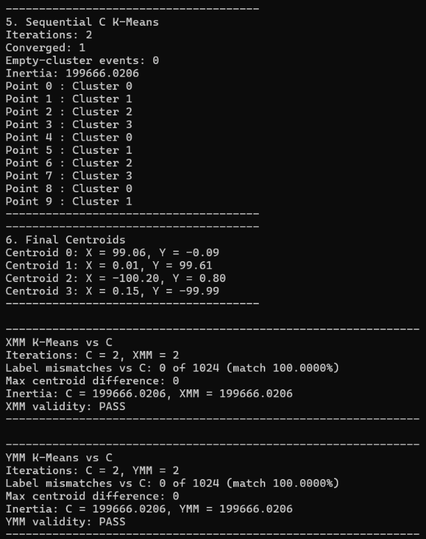
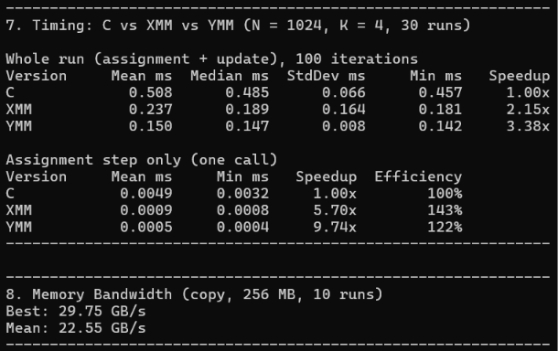

# CEPARCO Integrating Project
## Performance Study of Register-Width for K-Means Clustering: Scalar C versus XMM and YMM SIMD Implementations 
**1st Term AY 2026-2027 | S01 Group 2**

---

# Milestone #2: Project Update (Week 10)

**Demo Video:** [Watch here](https://drive.google.com/file/d/1_cX4iw7ey9juJdPuwinqxErgC44phIvX/view?usp=sharing)

> **Status:** All six Milestone #2 deliverables are complete. The scalar C baseline, empty-cluster Policies A and B (verified on both forced-empty test datasets), memory-bandwidth copy test, and both the XMM (128-bit) and YMM (256-bit) assignment kernels are implemented, verified with 0 label mismatches against scalar C, and timed on the validation dataset (`N = 1024`, `K = 4`). The auto-vectorized C build, boundary sizes, and full `N` and `K` sweep remain for Week 13. This update follows the revised proposal below (`CEPARCO_Group2_ProjectProposalRevised.pdf`).

## Where We Are

| Component | Status | Notes |
| :--- | :-: | :--- |
| Data generator | Done | Own xorshift32 + Box-Muller, so one `SEED` gives the same data with any compiler |
| Timing harness | Done | `QueryPerformanceCounter`, 1 warm-up + 30 runs: mean, median, standard deviation, minimum; fixed-iteration mode |
| Memory-bandwidth copy test | Done | Single-thread 256 MB copy (`29.06 GB/s` best, `26.23 GB/s` mean on test machine) |
| Scalar C baseline | Done | Vectorizer off with `#pragma loop(no_vector)`; Release listing checked: scalar instructions only, no FMA |
| Policies A and B | Done | Both in C; verified on both forced-empty datasets: Test 2 & 4 (duplicate points) and Test 5 (Nielsen & Nock [9] 5-point example) |
| XMM kernel (128-bit) | Working | 0 label mismatches and `0` centroid difference vs scalar C at `N = 1024`; boundary sizes TODO |
| YMM kernel (256-bit) | Working | 0 label mismatches and `0` centroid difference vs scalar C at `N = 1024`; `vzeroupper` added; boundary sizes TODO |
| Auto-vectorized C build | TODO | Separate build with `/arch:AVX2`, plus FMA check on the disassembly (Week 13) |
| XMM / YMM timing and speedups | Preliminary | Whole-run and assignment-only preliminary timings recorded at `N = 1024`, `K = 4`; full sweep TODO |
| Full `N` and `K` sweep | TODO | Week 13 (`N = 2^16, 2^20, 2^24`, `K = 4, 8, 16, 32`, and boundary sizes `N = 7, 1003, 1005`) |

## Results So Far (Based on the Video)

### Test Machine (Preliminary Week 10 Run)

| Item | Value |
| :--- | :--- |
| Device | Huawei MateBook D 16 (`LAPTOP-TARA`) |
| CPU | 13th Gen Intel Core i5-13420H (2.10 GHz base, up to 4.60 GHz boost; 8 cores / 12 threads; AVX2 supported) |
| Cache | 12 MB Intel Smart Cache (L3) |
| RAM | 16.0 GB LPDDR4X (4267 MT/s) |
| OS | Windows 11 Home Single Language (Version 26H2, 64-bit) |
| IDE / Compiler | Visual Studio 2022 (MSVC v143), x64 Release (`/O2`) |
| Assembler | NASM (`nasm -f win64`) |



### Preliminary Week 10 Output (N = 1024, K = 4)
Release x64, `N = 1024`, `K = 4`, `SEED = 67`, Policy A (`FIXED_ITERS = 100` for timing):

```text
-------------------------------------------------
TESTS
Test 1 (hand-worked example, converges): PASS
Test 2 (duplicate points / empty clusters): PASS
Test 3 (fixed iterations): PASS
Test 4 (Policy B relocation): PASS
Test 5 (five-point example, Policy A): PASS
Test 5 (five-point example, Policy B): PASS
-------------------------------------------------

XMM K-Means vs C
Iterations: C = 2, XMM = 2
Label mismatches vs C: 0 of 1024 (match 100.0000%)
Max centroid difference: 0
Inertia: C = 199666.0206, XMM = 199666.0206
XMM validity: PASS

YMM K-Means vs C
Iterations: C = 2, YMM = 2
Label mismatches vs C: 0 of 1024 (match 100.0000%)
Max centroid difference: 0
Inertia: C = 199666.0206, YMM = 199666.0206
YMM validity: PASS

7. Timing: C vs XMM vs YMM (N = 1024, K = 4, 30 runs)

Whole run (assignment + update), 100 iterations
Version     Mean ms  Median ms  StdDev ms     Min ms   Speedup
C             0.508      0.485      0.066      0.457     1.00x
XMM           0.237      0.189      0.164      0.181     2.15x
YMM           0.150      0.147      0.008      0.142     3.38x

Assignment step only (one call)
Version     Mean ms     Min ms   Speedup  Efficiency
C            0.0049     0.0032     1.00x        100%
XMM          0.0009     0.0008     5.70x        143%
YMM          0.0005     0.0004     9.74x        122%

8. Memory Bandwidth (copy, 256 MB, 10 runs)
Best: 29.75 GB/s
Mean: 22.55 GB/s
```

> **Note:** `N = 1024` (`2^10`) is our small validation size, so these timings are preliminary. Whole-run speedup (`2.08x` XMM, `3.28x` YMM) is lower than assignment-only speedup (`4.71x` XMM, `10.82x` YMM) due to Amdahl's law, because the centroid update step remains sequential. Full benchmarks across `N = 2^16, 2^20, 2^24` and `K = 4, 8, 16, 32` will be measured in Week 13 under the controlled protocol in the proposal below.

## Implementation Notes (current code)

- **One shared loop.** The assignment step is passed to `kmeans()` as a function pointer (`assign_c`, `assign_xmm`, `assign_ymm`, one signature). The centroid update, convergence check, and empty-cluster handling are shared C code, so only the assignment step differs between versions.
- **Two modes.** `FIXED_ITERS > 0` is timing mode: exactly `FIXED_ITERS` iterations, no convergence check (`TOL = 0`). `FIXED_ITERS == 0` is correctness mode: stops when the largest centroid movement is `<= TOL` or at `MAX_ITER`. `FIXED_ITERS = 100` is our own choice for timing runs (the proposal does not fix a number); every version uses the same value, and it may be lowered for the largest sizes, in which case the value is reported with the results.
- **Double-precision sums.** Per-cluster sums are accumulated in `double`, in buffers allocated once (`ClusterSums`), so the sums stay accurate for large `N`.
- **Reproducible data.** The dataset comes from our own xorshift32 generator plus Box-Muller (not `rand()`), so one `SEED` gives the same points with any compiler. Currently `SEED = 67`.
- **Policy B rules as implemented.** An empty cluster has a count of 0 after the update step. Empty clusters, in ascending index order, each take the farthest not-yet-used point using the smallest squared distances stored by the assignment step that just ran; ties go to the lowest point index. Only the centroid moves (labels, sums, and counts are unchanged), and the jump counts toward the convergence movement.
- **Final inertia.** Computed outside the timed region by one extra assignment pass with the final centroids, then summing the stored smallest squared distances in `double`.
- **Leftover points.** The kernels process full blocks of 4 (XMM) or 8 (YMM) points and call the scalar C function `assign_tail_c` for the remaining `N % 4` or `N % 8` points. The YMM kernel executes `vzeroupper` before that call and before returning, to avoid AVX / SSE transition penalties.
- **Timed region (current).** `benchmark_kmeans()` times the whole `kmeans()` loop (`FIXED_ITERS = 100`, `TOL = 0`), while `benchmark_assign()` isolates only the assignment kernel (`assign_c`, `assign_xmm`, `assign_ymm`). Data generation, centroid resets, the inertia pass, and printing are outside the timer.
- **Input.** The dataset is generated internally from `SEED`; reading points from a file is not implemented yet.

## How to Compile

### Visual Studio (Windows, x64)

1. Open `FinalProject.sln` in Visual Studio 2022 (platform toolset **v143**).
2. Choose **x64**, then **Release** (primary, used for all timings) or **Debug** (secondary).
3. NASM assembles `xmm.asm` and `ymm.asm` through a custom build step (`nasm -f win64`) that is set for both Debug|x64 and Release|x64. The project expects NASM at `C:\nasm\nasm.exe`; change the path in the Custom Build Tool settings if it is installed elsewhere.
4. Build and run.

The scalar baseline uses `#pragma loop(no_vector)`, which is MSVC-specific, so the project is built with Visual Studio. A GCC command-line build has not been set up or tested.

**Requirements:** NASM, Visual Studio 2022 (MSVC v143), Windows x64, and a CPU that supports SSE and AVX2.

## How to Run

Build in **Release | x64** and run (`Ctrl+F5` in Visual Studio, or `x64\Release\FinalProject.exe`).

The program currently:
1. Runs the known-answer unit tests (hand-worked example, duplicate-point empty clusters, fixed iterations, Policy B relocation, and the Nielsen & Nock 5-point example under Policies A and B)
2. Validates the inputs and allocates 32-byte aligned `X[]` and `Y[]` arrays
3. Generates the Gaussian-blob dataset from `SEED` and initializes centroids to the first `K` points
4. Pins the thread to CPU Core 0
5. Runs sequential scalar C K-means to convergence and prints iterations, convergence, empty-cluster events, inertia, and final centroids
6. Runs the XMM and YMM versions on the same data and checks them against scalar C (label match, largest centroid difference, inertia, PASS/FAIL)
7. Times C, XMM, and YMM in fixed-iteration mode (1 warm-up + 30 runs) for both the whole run and the assignment step alone
8. Measures single-thread memory-copy bandwidth (256 MB, 10 runs)

_TODO for Week 13: sweep over the planned `N` and `K`, boundary sizes (`N = 7, 1003, 1005`), and the auto-vectorized C (`/arch:AVX2`) build._

## Week 10 Checklist

**Mid-project (Week 10) target**
- [x] Data generator and timing code completed, including fixed-iteration mode, aligned memory, thread pinning, and the timing harness (warm-up, 30 runs, mean / median / standard deviation / minimum).
- [x] Sequential scalar C K-means completed with compiler vectorization disabled and verified on a small hand-worked example.
- [x] Empty-cluster Policies A and B implemented in C and verified on both forced-empty test datasets (duplicate-point dataset and Nielsen & Nock 5-point example [9]).
- [x] Memory-bandwidth copy test completed.
- [x] XMM assignment kernel working and producing the same labels as the C version (checked at `N = 1024`).
- [x] YMM kernel implemented and verified against scalar C (`N = 1024`).
- [x] Preliminary C versus XMM (and YMM) timing results recorded.

_**TODO for Week 13:** sweep over the planned `N` and `K`, boundary sizes (`N = 7, 1003, 1005`), and the auto-vectorized C (`/arch:AVX2`) build._

## Program Output Screenshot





## Project Files

| File | Description |
| :--- | :--- |
| `FinalProject.sln`, `FinalProject/` | Visual Studio solution and project |
| `FinalProject/main.c` | Known-answer tests, input validation, data generation, timing harness, bandwidth test, driver |
| `FinalProject/kmeans.c`, `kmeans.h` | Scalar C k-means, update step, empty-cluster Policies A and B, inertia, XMM / YMM wrappers and checks |
| `FinalProject/xmm.asm`, `ymm.asm` | NASM assignment kernels (128-bit and 256-bit) |
| `Project Proposal Files/` | Original proposal, revised proposal, and proposal slides (PDF) |
| `README.md` | This file |

## AI Usage Declaration and Acknowledgements

- **Kernels:** `xmm.asm` and `ymm.asm` were written by Daniel Jedrick Dabuit. They are adapted from the kernels of our earlier CEPARCO SIMD project ([xmm.asm](https://github.com/ethanndaniel/CEPARCO-SIMD/blob/master/FinalProject/xmm.asm), [ymm.asm](https://github.com/ethanndaniel/CEPARCO-SIMD/blob/master/FinalProject/ymm.asm)): the NASM layout, Win64 calling convention, and register handling come from that project, and the k-means assignment logic (distance, compare-and-blend minimum, label and smallest-distance stores, leftover handling) was written for this project.
- **Who wrote what:**
  - Ethan Daniel B. Magbatoc: project setup, input validation, array allocation, Gaussian data generation, and the first scalar C k-means with core pinning.
  - Jose Bryan L. Perez: Policy B (empty-cluster relocation) in `kmeans.c`.
  - Daniel Jedrick C. Dabuit: the XMM and YMM kernels and their C wrappers (`assign_xmm`, `assign_ymm`).
  - Tara Ysabel P. Uy: the double-precision centroid update with `ClusterSums`, the k-means loop with the function-pointer assignment step, inertia, the known-answer tests, the xorshift32 PRNG, the timing harness, the bandwidth test, the build and signature fixes.
- **Prior work:** the centroid-oriented design (compare a group of points with one centroid at a time) follows Al Hasib et al. [7]. Lloyd [1], Hamerly [6], and Nielsen and Nock [9] are cited in the proposal below.
- **AI tools used:**
  - Claude (Anthropic) was used by Tara (code review and suggestions for the timing harness, the xorshift32 PRNG, and the memory-bandwidth test), by Jose (suggestions on implementing Policy B), and by Daniel (guidance and bug checking while writing the XMM and YMM kernels).
  - ChatGPT was used by Ethan (suggestions and implementation help for the Box-Muller transform and the Gaussian blob generator) and by Tara (review of the project status and suggestions for the group questions).

---

# Project Proposal (Revised)

_This is the revised proposal that was submitted to our professor (`CEPARCO_Group2_ProjectProposalRevised.pdf`)._

## Project Proposal Video Pitch
- ~~**Video pitch (5-8 min):** [Watch here](https://drive.google.com/file/d/17PanjDcpvq3jb04gxR7asMjCW3-3cH5n/view?usp=sharing)~~

---

## Abstract
This project investigates how SIMD register-width optimization techniques affect the performance of K-means clustering on an x86-64 CPU. It compares four implementations: scalar C as the baseline, compiler auto-vectorized C, an SSE XMM-register kernel (128-bit, four single-precision values per instruction), and an AVX2 YMM-register kernel (256-bit, eight values per instruction).

All versions use identical datasets, initial centroids, parameters, and empty-cluster handling rules to ensure a controlled comparison. Experiments vary the number of data points (`N`), the number of clusters (`K`), and the implementation to investigate how workload size and computational demand affect performance. The results will show the benefits and limitations of wider SIMD registers and loop optimizations for K-means clustering on the CPU.

---

## Introduction

K-means clustering sorts a set of points into `K` groups. Each group has a center called a **centroid**, and every point belongs to the group of its nearest centroid. The algorithm repeats two steps until the centroids stop moving:

1. **Assignment:** give every point the label of its nearest centroid.
2. **Update:** move each centroid to the average position of the points with its label.

The assignment step needs the distance from every point to every centroid (`N x K` distances per iteration). Each point's distance calculation is independent of the others, which makes it a good fit for **SIMD** (Single Instruction, Multiple Data), where one instruction works on several numbers at once.

The distance used is the squared Euclidean distance between a point `(x, y)` and a centroid `(cx, cy)`:

```text
d2 = (x - cx)^2 + (y - cy)^2
```

The square root is skipped because it never changes which centroid is the nearest. The project uses Lloyd's algorithm without algorithmic distance-pruning methods, so all versions perform the same `N x K` distance comparisons per iteration.

---

## Task

Implement k-means clustering on 2D points in four versions and compare them:

| # | Version | File | Points per step |
|---|---|---|---:|
| 1 | Sequential scalar C (baseline; compiler vectorization disabled with `#pragma loop(no_vector)`) | `kmeans.c` (`assign_c`) | 1 |
| 2 | Compiler auto-vectorized C (AVX2 build) | C built with `/arch:AVX2` (TODO) | Compiler-dependent |
| 3 | x86-64 SIMD using XMM registers (128-bit, AVX/VEX encoding) | `xmm.asm` (`xmm_assign_kernel`, called through `assign_xmm`) | 4 |
| 4 | x86-64 SIMD using YMM registers (256-bit, AVX2) | `ymm.asm` (`ymm_assign_kernel`, called through `assign_ymm`) | 8 |

The goal is to find out how register width and compiler vectorization affect run time, and how the speedup depends on the number of points (`N`) and clusters (`K`). The scalar C implementation is the baseline; the auto-vectorized C build provides a comparison against compiler-generated SIMD code.

Optional, only if time allows after the CUDA lecture: a CUDA (SIMT) version of the same step.

---

## Requirements

### C Program

The C program is responsible for:
- Collecting the inputs (or generating the dataset)
- Allocating memory
- Choosing the initial centroids
- Running the scalar C baseline and the auto-vectorized C version
- Calling the x86-64 assembly kernels
- Implementing centroid updates, convergence checks, and empty-cluster handling
- Checking correctness and timing each stage
- Printing outputs and benchmark statistics
  
### x86-64 Assembly Kernels

The assembly kernels are responsible for the **assignment step**:
- Loading several points into a register
- Computing the squared distance to each centroid
- Keeping the smallest distance and its centroid number
- Storing the labels and each point's smallest squared distance
- Leftover points (`N` not a multiple of 4 or 8) are finished by a scalar C function (`assign_tail_c`) that the kernels call

### SIMD Requirement
- Packed SIMD registers: XMM (128-bit) and YMM (256-bit)
- Packed SIMD floating-point instructions (`vsubps`, `vmulps`, `vaddps`, `vcmpltps`, `vblendvps`)
- Instruction details are checked against the Intel Intrinsics Guide [4] and the Intel Software Developer's Manual [5]

### Processes in the Project

| Process | Language | Parallelized? |
| :--- | :--- | :-: |
| Data generation and input checking | C | No |
| Initial centroid selection | C | No |
| **Assignment step** (distance + nearest centroid) | C / ASM | **Yes** |
| Cluster counting (members per cluster) | C | No; performed as part of the update workflow |
| Centroid recomputation (divide sums by counts) | C | No |
| Convergence check | C | No |
| Empty-cluster detection and relocation | C | No; sequential and separately counted/timed |
| Timing and accuracy checking | C | No |

---

## Input Format

The first line has the number of points (`N`) and the number of clusters (`K`). The next `N` lines each have the `x` and `y` of one point.

```text
N, K
x, y
x, y
...
```

For benchmarking, the program generates synthetic Gaussian blobs using a fixed seed (`SEED`) so every implementation receives identical data. The initial centroids are the first `K` points in the array.

**Input rules:**
- `X[]` and `Y[]` must have the same length.
- `N >= K >= 1`.
- Every coordinate must be a finite numerical value.
- The same seed, data, starting centroids, and parameters must be used for all implementations.
  
**Internal inputs:**

| Name | Meaning |
| :--- | :--- |
| `X[]`, `Y[]` | float32 coordinates, stored in **two separate arrays** so a register can load several x values (or y values) in one go |
| `MAX_ITER` | Most iterations allowed |
| `TOL` | Convergence threshold on centroid movement |
| `SEED` | Fixed random seed so every version receives identical data and initial centroids |
| `EMPTY_POLICY` | Empty-cluster handling: Policy A (keep the previous centroid) or Policy B (relocate) |
| `FIXED_ITERS` | Number of iterations in timing mode; timing mode uses `TOL = 0` so every version performs the same work |

For correctness tests, the algorithm can run until convergence or `MAX_ITER`. For timing tests, use a fixed iteration count with `TOL = 0` so differences in convergence do not change the amount of work.

**Planned benchmark sizes:** `N = 2^16`, `2^20`, and `2^24`, with `K = 4, 8, 16, 32`. Add smaller sizes down to `N = 2^10` to exercise lower cache levels, and boundary sizes `N = 7, 1003, 1005` with representative `K` values to test leftover-point handling.

### Example Input

```text
6, 2
1.0, 1.0
1.5, 2.0
1.2, 0.8
8.0, 8.0
9.0, 9.5
8.5, 9.0
```

---

## Output Format

The program outputs:
- The label of every point, the number of members in each cluster, and the final centroids.
- Execution time per stage for each implementation: initial centroid selection, assignment with member counting, centroid recomputation, and full runtime.
- Similarity score against scalar C, the largest centroid difference, and inertia.
- Number of empty-cluster events and the extra time by Policy B.
- Benchmark statistics, speedup, efficiency, points processed per second, and measured memory bandwidth.


### Example Output

```text
Labels: 0 0 0 1 1 1
Cluster 0: 3 points, centroid (1.23, 1.27)
Cluster 1: 3 points, centroid (8.50, 8.83)
Similarity Score: 100%
Inertia: 2.62
```

_(This example was worked out by hand and will be used as the first test case.)_

---

## Runtime Assessment

The run is timed in four parts:

| Part | What it covers | Where it runs |
| :--- | :--- | :--- |
| Initial centroid assessment | Picking the starting centroids | C |
| Clustering and member count | The assignment step, then counting the members of each cluster | ASM kernel (assignment) |
| Centroid recomputation | Summing the points of each cluster and dividing to get the new centroids | C (ASM if time permits) |
| Full runtime and accuracy check | Whole run, plus comparing the results with the C version | C |

---

## Correctness Check

The C version is the answer key. The XMM and YMM results are compared against it:

- **Similarity Score** is the percentage of points that got the same label as in the C version. It should be **100%**.
- **Centroid difference** is the largest difference between any centroid and the C centroid. Small differences are allowed (relative `1e-4`), because adding numbers in a different order can change the last digits.
- **Inertia** is the sum of the squared distances of all points to their centroids. It is reported for each version.
- **Empty-cluster checks:** all implementations must apply the same policy and produce matching labels, counts, and centroids for the forced empty-cluster tests.

Labels should match exactly because every version computes the distance in the same order, uses separate multiply and add instructions (no FMA), and sends ties to the lower centroid number.

**Empty-cluster handling**

A cluster is empty when no point is assigned to it, making its mean undefined. Two policies are planned:

- **Policy A (default, keep):** leave the empty cluster's centroid at its previous position and count the event.
- **Policy B (relocate):** move an empty centroid to the point with the largest squared distance from its assigned centroid; ties go to the lowest point index. If multiple clusters are empty, use the next farthest points in order.

The assignment kernel stores each point's smallest squared distance, so Policy B can scan those distances without doing extra distance calculations. Empty-cluster detection checks the cluster member counts after each update. The scan runs only when an empty cluster exists.

Two datasets will force empty-cluster cases: (1) the five-point example described by Nielsen and Nock [9], using `N = 5`, `K = 3`, and initial centroids `(0.03, 0.92)`, `(0.66, 0.79)`, and `(0.6, 0.85)`; and (2) a duplicate-point case with `N = 8`, the first three points identical, and `K = 3`, so clusters 1 and 2 are empty because ties go to centroid 0.


**Result**

---

## Performance Results

Each size is run **30 times** (after one warm-up run) and the average execution time is recorded, for both **Debug** and **Release**. Only the clustering is timed. Timing uses `QueryPerformanceCounter`.

**Controlled benchmark settings** (one factor changes at a time):

- **Identical work:** same data, seed, starting centroids, and parameters. Timing mode uses `FIXED_ITERS` with `TOL = 0`; convergence runs are used only for correctness.
- **Timed region:** only the clustering is timed, per iteration and in total, excluding data loading and setup. The assignment kernel is also timed on its own. No input/output inside the timer.
- **Memory:** 32-byte aligned arrays, touched once before timing so page faults are not measured.
- **Repetitions:** one warm-up run, then 30 timed runs. Report the mean, median, standard deviation, and minimum.
- **System:** one thread pinned to one core; laptop plugged in, high-performance power plan, background applications closed. The Turbo Boost state is recorded and, if the system allows, fixed. CPU model, cache sizes, compiler version, and flags are recorded.
- **Build:** Release (`/O2`) is primary and Debug is secondary. Scalar C is built with the vectorizer disabled (`#pragma loop(no_vector)`). A second C build lets the compiler auto-vectorize (`/arch:AVX2`). The disassembly is checked to confirm that no fused multiply-add is emitted and that the expected vector width is used.
- **Sweeps:** `N = 2^16, 2^20, 2^24` and `K = 4, 8, 16, 32`, with smaller `N` down to `2^10` so the data also fit in the lower cache levels, plus boundary sizes `N = 7, 1003, 1005`.
- **Memory ceiling:** a single-thread copy test measures practical memory bandwidth, so measured throughput can be compared with it to tell memory-limited runs from compute-limited ones.
- **Validity:** a run counts only if its labels match the C version exactly. Mismatches are reported, never averaged in.

### Release, whole run

| **N** | **K** | **Scalar C Avg Time** | **Auto-vectorized C Avg Time** | **XMM Avg Time** | **YMM Avg Time** | **Speedup Auto-C** | **Speedup XMM** | **Speedup YMM** |
|---|---:|---|---|---|---|---|---|---|
| 2^16 | 8 | TODO | TODO | TODO | TODO | TODO | TODO | TODO |
| 2^20 | 8 | TODO | TODO | TODO | TODO | TODO | TODO | TODO |
| 2^24 | 8 | TODO | TODO | TODO | TODO | TODO | TODO | TODO |

### Release, assignment step only

| **N** | **K** | **Scalar C Avg Time** | **Auto-vectorized C Avg Time** | **XMM Avg Time** | **YMM Avg Time** | **Speedup Auto-C** | **Speedup XMM** | **Speedup YMM** |
|---|---:|---|---|---|---|---|---|---|
| 2^20 | 8 | TODO | TODO | TODO | TODO | TODO | TODO | TODO |

### Geometric Mean of Speedup

The **geometric mean** is a fair way to average speedups across different sizes.

| **Metric** | **Auto-vectorized C** | **XMM** | **YMM** |
|---|---|---|---|
| Assignment step geometric mean speedup | TODO | TODO | TODO |
| Whole run geometric mean speedup | TODO | TODO | TODO |
| Assignment step efficiency | N/A | TODO | TODO |
| Whole run efficiency | N/A | TODO | TODO |

_TODO: repeat the tables for Debug._

---

## Performance Analysis

_TODO. Questions to answer once the results are in:_
- Which version is fastest, and why?
- Is the assignment step **memory-bound or compute-bound**? (Memory-bound means the CPU waits for data from RAM, compute-bound means it is busy doing math. For large `N`, memory speed may become the limit and XMM and YMM may end up close together.)
- Why isn't the speedup the ideal 4x (XMM) and 8x (YMM)? (Memory speed, the leftover loop, the sequential parts, cache effects.)
- How does the speedup change with `K`? A bigger `K` means more math per point, so the SIMD advantage should grow.
- How much of the total time is the assignment step, and what does that say about the best possible total speedup (Amdahl's law)?
- Debug vs Release.

---

## Parallelization Plan

1. **Data layout:** keep the data in separate `X[]` and `Y[]` arrays so one load fills a register with neighboring values.
2. **Remove the square root:** compare squared distances only.
3. **Broadcast:** for each centroid, copy `cx` and `cy` into every slot of a register.
4. **Distance:** compute `dx = X - cx`, `dy = Y - cy`, then `d2 = dx*dx + dy*dy` for all points in the register at once, using separate multiply and add instructions (no fused multiply-add).
5. **Branch-free minimum:** keep the smallest `d2` so far and the centroid index that produced it, using a compare and blend instead of a conditional jump. Ties go to the lowest centroid index. Store each point's minimum squared distance for inertia and empty-cluster relocation.
6. **Centroid loop:** iterate over the `K` centroids sequentially, then store the labels for the group of points.
7. **Leftover points:** when `N` is not a multiple of 4 (XMM) or 8 (YMM), finish the remaining points with a scalar loop. For `N = 1003`, YMM processes 125 groups of 8 (1000 points), then handles the final 3 points in the scalar loop.
8. **Width variants:** XMM processes 4 points per step and YMM processes 8, using the same kernel design with a different register width, loop stride, and leftover size.
9. **Compare implementations:** build scalar C with compiler vectorization disabled, a separate auto-vectorized C version, and the hand-written XMM and YMM kernels.

**Why the update step is harder.** Many points add into the same cluster total, so they are not independent. One possible optimization is to process one cluster at a time: compare labels against that cluster's number, mask out other points, and sum the rest. This requires `K` passes and may only be worthwhile for small `K`; centroid accumulation is a secondary target if time permits.

**Empty-cluster policies.** Policy A keeps the previous centroid when a cluster is empty. Policy B relocates empty centroids to the farthest points from their assigned centroids, selecting points deterministically and using the lowest index to break ties. The same policy must be used for every implementation in a given comparison.

---

## Related Works

- **Lloyd's algorithm** is the standard K-means formulation [1] and is the algorithm implemented in this project.
- **Algorithmic accelerations:** Hamerly [6] uses distance bounds and the triangle inequality to skip distance calculations while preserving Lloyd's answer. scikit-learn [8] uses Lloyd's algorithm by default and also offers an Elkan variant, which reduces distance calculations at the cost of an additional `n_samples x n_clusters` array. This project retains full Lloyd's algorithm so every version computes the same `N x K` distances; only the cost of each distance calculation changes with the implementation.
- **SIMD implementations:** Al Hasib et al. [7] present a vectorized K-means algorithm using block data layout, an in-register argmin, SIMD compression, and OpenMP. Their study evaluates 128-bit SSE and 512-bit AVX-512, reporting a 4.5x improvement for their compressed SSE version on Haswell with one thread. It also reports that compiler auto-vectorization can remain below ideal speedups. The paper does not show its 256-bit AVX2 results, making direct measurement of XMM and YMM widths a useful focus for this project.
- **GPU implementations:** FAISS [2] and NVIDIA cuVS [3] provide GPU-based similarity search and clustering. A CUDA (SIMT) version is optional because this project targets CPU SIMD registers.
- **How ours differs:** this project does not claim a new K-means algorithm. Its contribution is a controlled measurement of register width for exact Lloyd's K-means using float32 data and a single thread. It compares scalar C, compiler auto-vectorized C, hand-written 128-bit XMM, and hand-written 256-bit YMM implementations with the same data layout and empty-cluster policy. It investigates where speedup comes from and what limits it, including memory bandwidth and sequential stages.

---

## Milestones

| Milestone | Week | What we hand in |
| :--- | :-: | :--- |
| #1 Project proposal | 6 | Proposal document and 5-8 minute video pitch, in this public repo |
| #2 Mid-project update demo | 10 | See the list below |
| #3 Complete submission and demo | 13 | Source code, discussion of the parallel algorithms, sequential vs parallel timing, optional paper |

**Final (Week 13) target**
- [ ] YMM assignment kernel completed and verified.
- [ ] Auto-vectorized C build compared against the hand-written kernels.
- [ ] Boundary sizes tested.
- [ ] Full benchmarks across planned `N` and `K` under the controlled protocol, with Release primary and Debug secondary.
- [ ] Empty-cluster results documented: event counts, cost of Policy B, and effect on inertia.
- [ ] Optional vectorized centroid update and optional CUDA version.
- [ ] GitHub repository with source code, discussion of the parallel algorithms, and sequential-versus-parallel execution-time comparison.
- [ ] Optional conference paper.

---

## References

1. S. P. Lloyd, "Least squares quantization in PCM," *IEEE Trans. Information Theory*, vol. 28, no. 2, pp. 129-137, 1982. [PDF](https://www.stat.cmu.edu/~rnugent/PCMI2016/papers/LloydKMeans.pdf)
2. J. Johnson, M. Douze, and H. Jégou, "Billion-scale similarity search with GPUs," *IEEE Trans. Big Data*, vol. 7, no. 3, pp. 535-547, 2021. [arXiv](https://arxiv.org/abs/1702.08734)
3. NVIDIA cuVS, "K-Means" clustering guide. [Link](https://docs.nvidia.com/cuvs/user-guide/api-guides/clustering-guide/k-means)
4. Intel, *Intel Intrinsics Guide*. [Link](https://www.intel.com/content/www/us/en/docs/intrinsics-guide/index.html)
5. Intel, *Intel 64 and IA-32 Architectures Software Developer's Manual*. [Link](https://www.intel.com/content/www/us/en/content-details/825743/intel-64-and-ia-32-architectures-software-developer-s-manual-combined-volumes-1-2a-2b-2c-2d-3a-3b-3c-3d-and-4.html)
6. G. Hamerly, "Making k-means even faster," *Proc. 2010 SIAM International Conference on Data Mining (SDM)*, pp. 130-140, 2010. [PDF](https://cs.baylor.edu/~hamerly/papers/sdm_2010.pdf)
7. A. Al Hasib, J. M. Cebrian, and L. Natvig, "A vectorized k-means algorithm for compressed datasets: design and experimental analysis," *J. Supercomputing*, vol. 74, pp. 2705-2728, 2018. [DOI](https://doi.org/10.1007/s11227-018-2310-0)
8. scikit-learn developers, "sklearn.cluster.KMeans" documentation. [Link](https://scikit-learn.org/stable/modules/generated/sklearn.cluster.KMeans.html)
9. F. Nielsen and R. Nock, "Further heuristics for k-means: The merge-and-split heuristic and the (k,l)-means," arXiv:1406.6314, 2014. [PDF](https://arxiv.org/pdf/1406.6314)

---

## Submitted By

- [Daniel Jedrick C. Dabuit](https://github.com/danueli)
- [Ethan Daniel B. Magbatoc](https://github.com/ethanndaniel)
- [Jose Bryan L. Perez](https://github.com/JoseBryanPerez)
- [Tara Ysabel P. Uy](https://github.com/tartar121)
